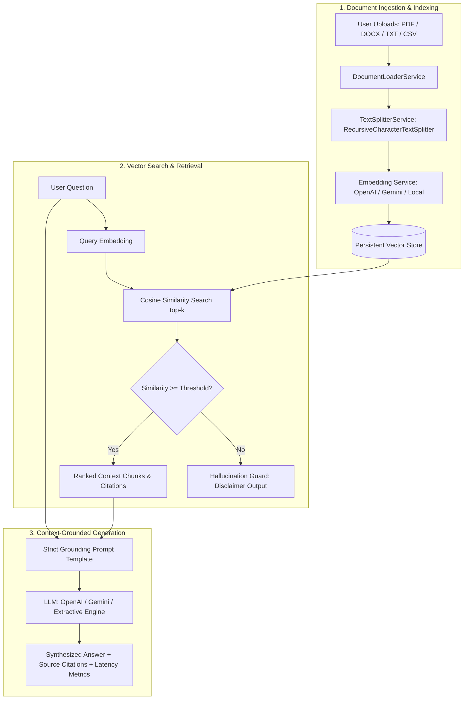

# 📚 RAG-Based Document Q&A System

[](https://www.python.org/)
[](https://fastapi.tiangolo.com/)
[](https://www.langchain.com/)
[](https://opensource.org/licenses/MIT)
[]()

A high-performance, production-grade **Retrieval-Augmented Generation (RAG) Document Question & Answer System**. This system enables users to upload heterogeneous document formats (PDF, DOCX, TXT, Markdown, CSV), processes and partitions them into semantic chunks, indexes them into a persistent vector store, and synthesizes accurate, hallucination-free answers grounded in the retrieved document context.

---

## 🌟 Key Highlights & Engineering Features

- **End-to-End RAG Pipeline**: Ingests unstructured documents, partitions them using semantic chunking with overlap preservation, computes dense vector representations, and conducts cosine similarity search to retrieve relevant context.
- **FastAPI Production Backend**: High-throughput asynchronous backend built with FastAPI, Pydantic v2 validation, modular services, and automatic OpenAPI/Swagger interactive documentation.
- **Grounding & Hallucination Mitigation**: Enforces strict prompt engineering and similarity score thresholding. If no document chunk meets the contextual threshold, the system explicitly disclaims unverified claims rather than hallucinating answers.
- **Auditable Source Citations**: Every generated response includes granular source attribution—document title, page number, chunk index, similarity score, and excerpted snippets.
- **Pluggable LLM & Embedding Architecture**:
  - **Groq Cloud**: Ultra-fast LLM inference (`openai/gpt-oss-120b`, `qwen/qwen3.8-27b`)
  - **Google Gemini**: High-dimensional embeddings (`gemini-embedding-001`, 3072-dim) and Gemini models
  - **Deterministic Local/Offline Engine**: Zero-cost, zero-API-key fallback mode using pure NumPy for vector math and deterministic local testing.
- **Interactive Modern Web Dashboard**: Built-in glassmorphic responsive UI featuring drag-and-drop document uploads, chunk preview, configurable Top-K & similarity sliders, and live conversational chat.

---

## 🏗️ System Architecture



---

## 📂 Project Directory Structure

```
RAG-Based Document Q&A System/
├── app/
│   ├── __init__.py
│   ├── main.py                     # FastAPI application factory & lifespan setup
│   ├── config.py                   # Pydantic v2 application configuration
│   ├── models/
│   │   ├── __init__.py
│   │   └── schemas.py              # Pydantic request & response models
│   ├── services/
│   │   ├── __init__.py
│   │   ├── document_loader.py      # Multi-format document parser (PDF, DOCX, TXT, CSV)
│   │   ├── text_splitter.py        # Semantic chunking with metadata enrichment
│   │   ├── embeddings.py           # Pluggable embeddings (OpenAI, Gemini, Local)
│   │   ├── vector_store.py         # Vector indexing, similarity ranking & persistence
│   │   └── rag_pipeline.py         # Grounded RAG orchestrator & hallucination guard
│   ├── api/
│   │   ├── __init__.py
│   │   └── routes.py               # REST API endpoints
│   └── static/
│       ├── index.html              # Modern web UI
│       ├── style.css               # Responsive stylesheet
│       └── app.js                  # Frontend client logic & state management
├── sample_docs/
│   └── rag_architecture_overview.txt
├── tests/
│   ├── __init__.py
│   ├── test_document_processor.py  # Tests for parser and splitter
│   ├── test_vector_store.py        # Tests for vector storage and cosine similarity
│   ├── test_rag_pipeline.py        # Tests for grounding and hallucination rejection
│   └── test_api_endpoints.py       # Integration tests for FastAPI endpoints
├── .env.example                    # Environment variable configuration template
├── .gitignore                      # Git ignore rules
├── requirements.txt                # Production dependencies
├── Dockerfile                      # Containerization specification
├── docker-compose.yml              # Multi-container orchestration
└── README.md                       # Documentation
```

---

## 🚀 Getting Started

### 1. Prerequisites
- Python 3.10+ installed
- Git

### 2. Clone the Repository
```bash
git clone https://github.com/RaghavGoyal6046/RAG-_BASED_DOCUMENT_QA_SYSTEM.git
cd "RAG-_BASED_DOCUMENT_QA_SYSTEM"
```

### 3. Create & Activate Virtual Environment
```bash
python3 -m venv venv
source venv/bin/activate  # On Windows: venv\Scripts\activate
```

### 4. Install Dependencies
```bash
pip install -r requirements.txt
```

### 5. Configure Environment Variables
Copy `.env.example` to `.env`:
```bash
cp .env.example .env
```
Edit `.env` to configure your preferred LLM provider and credentials:
```env
# Choose provider: "openai", "gemini", or "offline"
LLM_PROVIDER=openai
LLM_MODEL=gpt-4o-mini
OPENAI_API_KEY=your_openai_api_key_here

# Embeddings: "openai", "gemini", or "local"
EMBEDDINGS_PROVIDER=openai
EMBEDDINGS_MODEL=text-embedding-3-small
```
*(Note: If no API key is configured, the system automatically uses its built-in offline deterministic embeddings and grounded extractor—no API keys required to test!)*

### 6. Run the Application
```bash
uvicorn app.main:app --host 0.0.0.0 --port 8000 --reload
```
Open your browser and navigate to:
- **Interactive Web Interface**: [http://localhost:8000](http://localhost:8000)
- **Interactive Swagger API Docs**: [http://localhost:8000/docs](http://localhost:8000/docs)
- **ReDoc Documentation**: [http://localhost:8000/redoc](http://localhost:8000/redoc)

---

## 🧪 Running the Test Suite

The project includes unit and integration tests covering document ingestion, chunking, vector retrieval, hallucination mitigation, and all REST endpoints.

Run the tests with `pytest`:
```bash
pytest -v
```

---

## 📡 REST API Reference

| Method | Endpoint | Description |
|---|---|---|
| `GET` | `/api/v1/health` | Service health status and version. |
| `GET` | `/api/v1/stats` | System stats (total documents, total chunks, active models). |
| `POST` | `/api/v1/documents/upload` | Upload and index a document (PDF, DOCX, TXT, CSV, MD). |
| `GET` | `/api/v1/documents` | List all ingested documents and their metadata. |
| `DELETE` | `/api/v1/documents/{id}` | Delete a specific document and its indexed chunks. |
| `POST` | `/api/v1/query` | Submit a natural language question against indexed documents. |
| `DELETE` | `/api/v1/clear` | Clear all documents and reset the vector index. |

### Sample Query Request (`POST /api/v1/query`):
```json
{
  "question": "What is Retrieval-Augmented Generation?",
  "top_k": 4,
  "similarity_threshold": 0.25
}
```

### Sample Query Response:
```json
{
  "question": "What is Retrieval-Augmented Generation?",
  "answer": "Retrieval-Augmented Generation (RAG) is an AI framework that optimizes Large Language Model outputs by referencing an authoritative external knowledge base before generating a response.",
  "sources": [
    {
      "document_id": "9d4f0d23-...",
      "document_name": "rag_architecture_overview.txt",
      "chunk_index": 0,
      "page": 1,
      "content": "Retrieval-Augmented Generation (RAG) is an advanced AI framework...",
      "similarity_score": 0.8421
    }
  ],
  "confidence_score": 0.8421,
  "has_grounded_context": true,
  "latency_ms": 32.4,
  "model_used": "gpt-4o-mini"
}
```

---

## 🌐 Live Cloud Deployment (e.g. Render / Railway)

You can deploy this FastAPI RAG application to **Render** or **Railway** for free:

### Deploy to Render:
1. Push your repository to GitHub.
2. Log in to [render.com](https://render.com) and click **New +** -> **Web Service**.
3. Select your GitHub repository (`RAG-_BASED_DOCUMENT_QA_SYSTEM`).
4. Set the following configurations:
   - **Environment:** `Python 3`
   - **Build Command:** `pip install -r requirements.txt`
   - **Start Command:** `uvicorn app.main:app --host 0.0.0.0 --port $PORT`
5. Under **Environment Variables**, add:
   - `GROQ_API_KEY`: `your_groq_api_key`
   - `GEMINI_API_KEY`: `your_gemini_api_key`
   - `LLM_PROVIDER`: `groq`
   - `EMBEDDINGS_PROVIDER`: `gemini`
6. Click **Deploy Web Service**. Render will build and provide a live public HTTPS URL (e.g., `https://your-app.onrender.com`).

---

## 🛡️ Hallucination Guard Details

To prevent the LLM from synthesizing speculative or untrue facts:
1. **Cosine Similarity Threshold Filter**: If retrieved document chunks do not surpass the configurable similarity threshold, retrieval rejects them.
2. **Context Absence Detection**: When no context is verified, the pipeline returns a factual disclaimer: `"Based on the provided documents, I could not find information to answer this question."`
3. **Structured System Prompting**: Instructs the model to restrict its scope solely to the supplied context tokens and explicitly cite document source tags.

---

## 📄 License

This project is licensed under the [MIT License](LICENSE).
